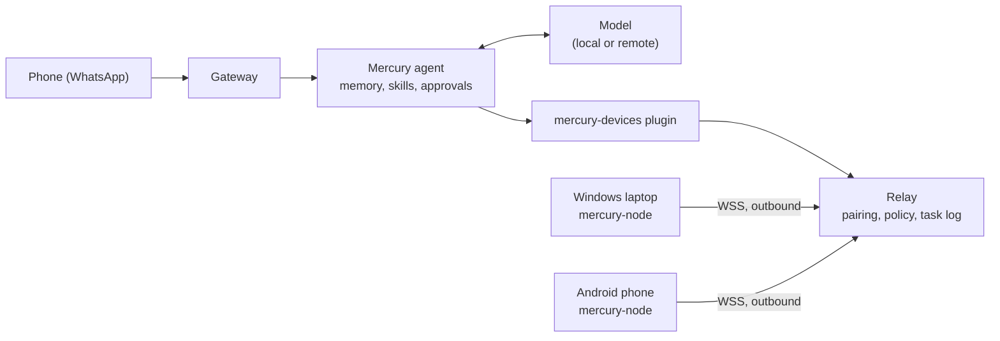

# Mercury hub

Mercury is a self-learning agent that works across your devices. You talk to it from your phone (WhatsApp), the command line or an API. It runs tasks on your paired Windows laptops, PCs and Android phones, returns verified results, and learns reusable skills as it goes.

This repository has two branches:

| Branch | What it is | Who installs it |
|---|---|---|
| **`hub`** (this one) | The agent, its memory and skills, the WhatsApp/API gateway, and the device relay | Whoever runs the office server |
| [`node`](../../tree/node) | A small client for each end-user device (Windows, Android/Termux, Linux, macOS) | Each user, on each device |

```bash
git clone -b hub --single-branch https://github.com/quantroninblue/mercury.git mercury-hub
```

Mercury is built on [Hermes Agent](https://github.com/NousResearch/hermes-agent) by Nous Research. See [NOTICE.md](NOTICE.md).

## How it fits together



Devices connect **out** to the hub, so they need no open ports, SSH server or VPN. If the hub goes down, devices just wait and reconnect. Details: [docs/architecture.md](docs/architecture.md), [docs/protocol.md](docs/protocol.md).

## Requirements

- Linux server (Ubuntu 22.04+ or Debian 12+; macOS and WSL2 also work), always on.
- `git`, `bash`, `curl`. The installer fetches the engine's pinned Python 3.14 and packages.
- A model: a local server (Ollama, LM Studio, vLLM, llama.cpp) or an API key for a hosted provider (`mercury model` lists them).
- For devices outside the office network: a domain name pointing at the server, and [Caddy](https://caddyserver.com) (or any TLS reverse proxy).
- For WhatsApp: Node.js 22+, and a phone number dedicated to Mercury.

## Install

```bash
cd mercury-hub
./install.sh                  # add --with-whatsapp to install the WhatsApp bridge too
```

This prepares the engine environment, then creates `~/.mercury` (config, secrets, persona, plugin link, skill sandbox) and puts `mercury` in `~/.local/bin`. It never overwrites an existing config or `.env`. Use `--home DIR` for another location.

## Configure

1. **Model.** Run `mercury model` and pick one. Any of these works:

   | Option | Setup | Notes |
   |---|---|---|
   | API key | `mercury model`, choose the provider, paste the key | Anthropic, OpenAI, OpenRouter, Google, xAI, DeepSeek, Mistral, Azure, Bedrock, Vertex and more. Recommended for a shared hub. |
   | Claude Code sign-in | `mercury model`, Anthropic, use Claude Code credentials | Reuses Claude Code's credential store. Needs a Claude Max plan with extra usage. |
   | ChatGPT plan | `mercury auth add openai-codex` | Opens a device-code sign-in in the browser |
   | Local model | `provider: custom` and `base_url` in `~/.mercury/config.yaml` | Ollama, LM Studio, vLLM, llama.cpp. Needs a 64K context window, so about 16 GB of free GPU or system memory. For Ollama, set `OLLAMA_FLASH_ATTENTION=1` and `OLLAMA_KV_CACHE_TYPE=q8_0` on the server to halve that. |

   Personal subscriptions are for testing. A hub that serves other people should use an API key or a local model.
2. **Public URL.** Set `MERCURY_PUBLIC_URL=https://mercury.example.com` in `~/.mercury/.env`. Copy [deploy/Caddyfile](deploy/Caddyfile), put in your domain, and run Caddy. It only exposes the device routes.
3. **WhatsApp** (when Mercury's number is ready):
   - In `~/.mercury/.env`, set `WHATSAPP_ENABLED=true` and `WHATSAPP_ALLOWED_USERS=<your number, country code, no +>`.
   - Run `mercury whatsapp` and scan the QR code with Mercury's phone.
   - WhatsApp does not officially support bots. Use a dedicated number and don't send bulk messages.

## Run

```bash
mercury relay            # device relay (terminal 1)
mercury gateway run      # WhatsApp + API server (terminal 2)
mercury                  # chat in the terminal
```

To run them as services, see [deploy/mercury-relay.service](deploy/mercury-relay.service) and [deploy/mercury-gateway.service](deploy/mercury-gateway.service).

## Pair a device

```bash
mercury pair laptop                       # prints a one-time code, valid 10 minutes
```

On the device, after installing the `node` branch:

```bash
mercury-node pair --hub https://mercury.example.com --code K7QM-2XPA
```

Then:

```bash
mercury devices                           # who is online
mercury run laptop "Get-Date" --verify "exit 0"   # test a task without the agent
mercury tasks                             # task log
mercury policy laptop --approval all      # ask before every command on this device
mercury revoke laptop                     # cut a device off immediately
```

## Hub and node on one machine

To try Mercury on a single computer, or to let it work only on the machine it runs on, install both branches there. Nothing needs to be exposed to the network:

```bash
./install.sh                                   # in the hub checkout
mercury relay &                                # relay on 127.0.0.1:8765
git clone -b node --single-branch https://github.com/quantroninblue/mercury.git ../mercury-node
cd ../mercury-node && python3 -m pip install --user .
mercury pair this-pc                           # prints a code
mercury-node pair --hub http://127.0.0.1:8765 --code <code>
mercury-node start
```

## Using Mercury

Ask in plain language, from WhatsApp or the CLI: *"What are the five largest files in Downloads on my laptop?"* Mercury picks the device, runs the task, checks the result and replies with the outcome and a task id.

| Command | Where | What it does |
|---|---|---|
| `/devices` | WhatsApp, CLI | list devices and whether they're online |
| `/device-tasks` | WhatsApp, CLI | recent device tasks |
| `/skills pending`, `/skills diff <id>`, `/skills approve <id>` | WhatsApp, CLI | review and approve skills Mercury has learned |
| `yes` / `no` | WhatsApp | answer an approval request for a risky command |

Without WhatsApp, any paired device can talk to Mercury with `mercury-node ask "..."`, approval prompts included.

### Self-learning

When Mercury has no skill for a task that will come up again, it follows [`mercury-learn-skill`](skills/mercury/mercury-learn-skill/SKILL.md):
1. Research the official docs.
2. Write a skill with a script, a test and a sample.
3. Run the test in the hub sandbox.
4. Do one verified real run on the device.
5. Ask you to approve the skill.

Next time it reuses the approved skill without researching again. `mercury_skill_stats` tracks how often each skill's tasks succeed, so failing skills get fixed.

## Security

| What is protected | How |
|---|---|
| Who can talk to Mercury | WhatsApp allowlist. Unknown senders get a pairing code or are ignored. The API server needs `API_SERVER_KEY`. |
| Which devices are trusted | One-time pairing codes and per-device tokens, stored hashed and revocable at any time |
| Traffic | TLS via Caddy. The admin API and the API server listen on localhost only. |
| Commands that never run | Disk wipes, formatting, boot changes and similar are refused for every device (`mercury_hub/policy.py`) |
| Commands that need your yes | Deleting, killing processes, installs, registry and service changes, privilege use. Fails closed after 5 minutes. Per device you can choose to approve every command, only risky ones, or none (`mercury policy`). |
| What the device allows | The node's own local policy can refuse anything |
| What Mercury learns | New or changed skills wait for approval (`/skills approve`) and are scanned |

## Development

```bash
python3 -m venv .venv && .venv/bin/pip install fastapi uvicorn websockets httpx pytest
.venv/bin/python -m pytest          # 76 tests: relay, policy, store, plugin, CLI, device ask
```

Layout:

```
mercury_hub/   relay, policy, store, CLI (ours)
plugin/        mercury-devices agent plugin (ours)
skills/        seed skills (ours)
config/        config, persona, skin and .env templates (ours)
deploy/        systemd units, Caddyfile
docs/          architecture, protocol, testing evidence
engine/        Hermes Agent v0.22.5 (MIT, Nous Research), one small download patch, see NOTICE.md
```

Test results: [docs/testing.md](docs/testing.md).

## Real devices

To choose a model and add a Windows laptop or an Android phone, follow [docs/device-setup.md](docs/device-setup.md). It also walks through device tasks, approvals, learning and reusing a skill, and revoking a device.
