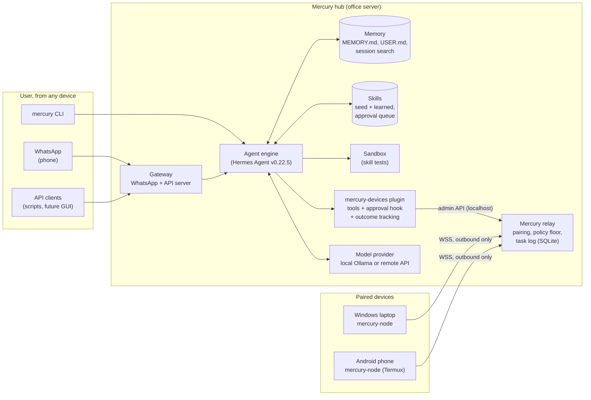

# Mercury architecture

Mercury is one agent that lives on a hub and acts on the user's devices. The hub holds all the intelligence (model access, memory, skills, task history). Devices run a small client (the `node` branch) that connects out to the hub and runs only what the hub sends and its own policy allows.

## Components

| Component | Where | What it does | Ours or reused |
|---|---|---|---|
| Agent engine | `engine/` | Agent loop, tool calling, memory, skills (`skill_manage`, `/skills approve`), approval gate, session store, gateway (WhatsApp bridge, API server), model providers (local and remote) | Reused: Hermes Agent v0.22.5 source (one small download patch, see NOTICE.md) |
| mercury-devices plugin | `plugin/mercury-devices/` | Tools `mercury_devices`, `mercury_run`, `mercury_task`, `mercury_tasks`, `mercury_skill_stats`. `pre_tool_call` hook sends risky device commands to the engine's human-approval gate. `post_tool_call` hook links task outcomes to the skills used. Slash commands `/devices`, `/device-tasks`. | Ours |
| Relay | `mercury_hub/relay.py` | WebSocket endpoint for nodes, one-time-code pairing, device registry, task dispatch, verified results, timeouts, revocation | Ours |
| Policy | `mercury_hub/policy.py` | Hard floor (always refused), approval rules for Windows and POSIX commands, per-device modes and blocked patterns | Ours (reuses the engine's POSIX detector when present) |
| Store | `mercury_hub/db.py` | SQLite: devices (hashed tokens), pairing codes (hashed), task log, skill outcomes | Ours |
| Persona and seed skills | `config/SOUL.md`, `skills/mercury/` | How Mercury picks devices, verifies, learns and reuses skills | Ours |

## Request flow: "check my laptop's battery health" from the phone

1. The WhatsApp message reaches the gateway. The allowlist (`WHATSAPP_ALLOWED_USERS`) is checked first.
2. The agent loads the persona and memory, then calls `mercury_devices` and picks `laptop` (Windows, online).
3. It looks for a matching skill (`skills_list`). **First time:** none exists, so it follows `mercury-learn-skill`:
   - researches `powercfg /batteryreport`
   - writes a skill with a parser script, a test and a sample report
   - runs the test in the hub sandbox
   - stages the skill for approval
4. It calls `mercury_run` with a command and a `verify_command`. The `pre_tool_call` hook classifies the command: read-only, so no approval needed. The plugin posts the task to the relay's admin API.
5. The relay checks the hard floor and sends the task over the laptop's socket. The node checks its local policy, runs the command and the check, and returns the result.
6. The relay records `verified`. The plugin returns the result to the agent, and the `post_tool_call` hook records the outcome against the skill.
7. The agent replies on WhatsApp with the result, the task id and "verified". The user approves the skill with `/skills approve <id>`.
8. **Next time:** `skills_list` shows the approved skill. The agent loads it with `skill_view` and runs it directly, without researching again.

## One conversation, any device

Messages from WhatsApp go into the WhatsApp session. Messages from paired devices (`mercury-node ask`, Mercury Desktop) all continue one shared hub conversation, labelled with the device they came from. Memory, skills and the task log are shared by everything. The agent can also search past sessions from any channel.

## Security layers

1. **Who can talk to Mercury:** a gateway allowlist, plus pairing codes for unknown senders (engine).
2. **Which devices exist:** one-time pairing codes and per-device revocable tokens, hashed at rest (relay).
3. **Transport:** TLS (Caddy) in front of the relay. The admin API and the API server listen on localhost only.
4. **What may run:**
   - the hub's hard floor
   - the human approval gate for risky commands (fails closed after 5 minutes)
   - per-device modes (`all` / `dangerous` / `none`) and blocked patterns
   - the node's own local policy
5. **What the agent learns:** new or changed skills are staged until a person approves them (`skills.write_approval: true`), and agent-written skills are scanned (`skills.guard_agent_created`).

## Continuous improvement

- **Outcome tracking:** every finished device task is linked to the skills loaded in that session. `mercury_skill_stats` shows success rates, worst first, with recent failures. The persona tells the agent to check it after failures and patch the skill. Patches also go through approval.
- **Engine features used as-is:** background review after turns, the creation nudge (`skills.creation_nudge_interval`), memory nudges and session search over past conversations.

## What runs where

| Process | Command | Listens on |
|---|---|---|
| Relay | `mercury relay` | 127.0.0.1:8765 (public via Caddy: `/health`, `/v1/pair`, `/v1/node`) |
| Gateway | `mercury gateway run` | WhatsApp bridge (outbound), API server 127.0.0.1:8642 |
| CLI chat | `mercury` | none |
